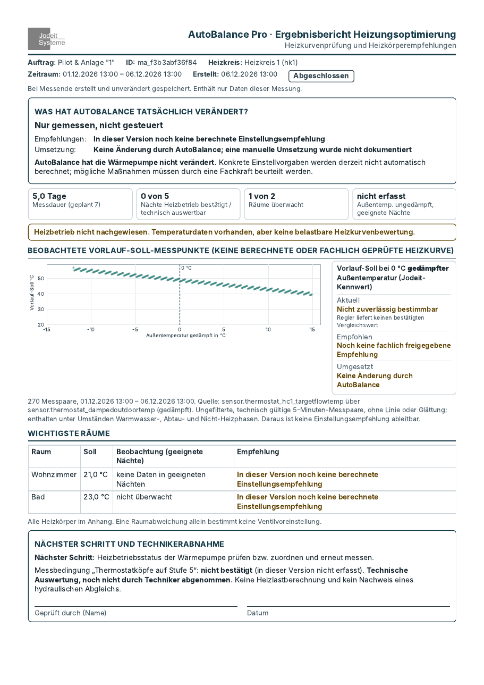
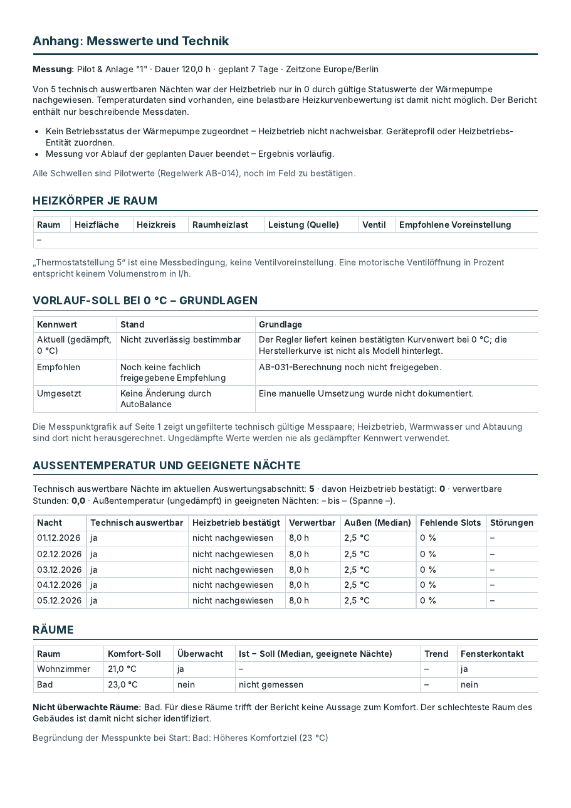
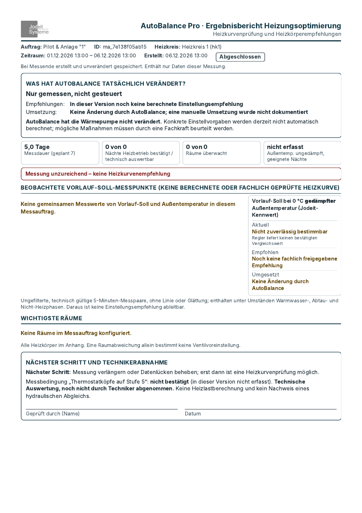
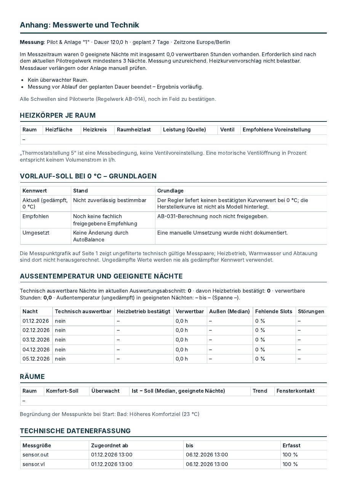
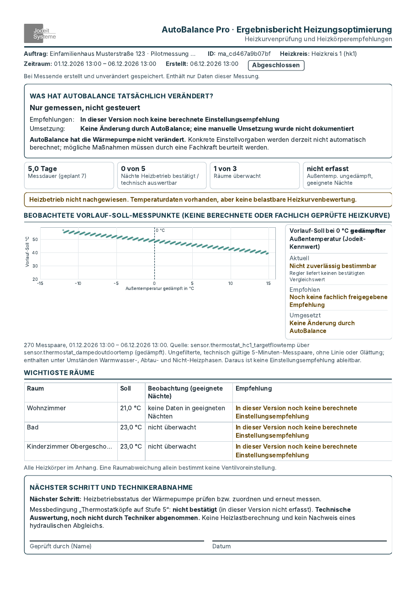
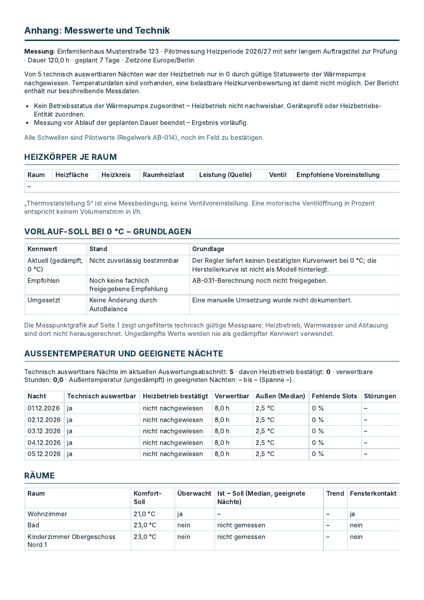
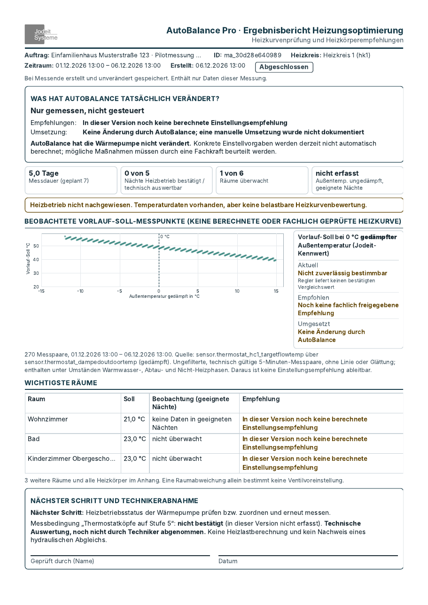
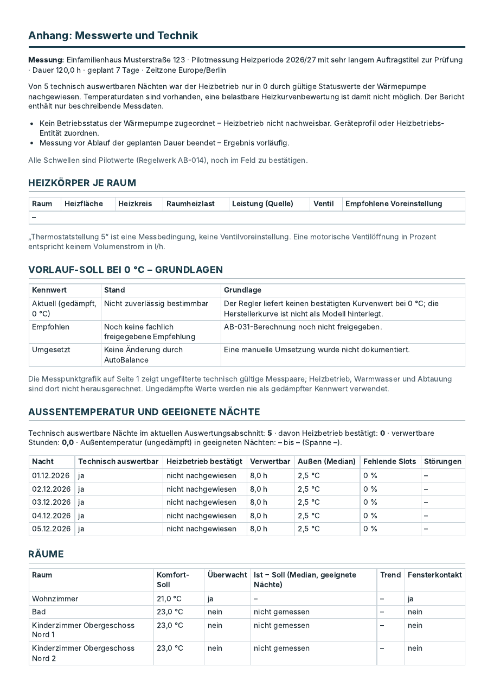

# AB-030 Teil 2 · Druckbilder zur visuellen Abnahme

Erzeugt aus PR #28, Commit `eadb3e0`, mit `AB030_PDF_OUT=… AUTO_BALANCE_UI_TESTS=1 python -m unittest tests.test_report_pdf`
(Chromium, A4, Druckmedium). Nur Testdaten, keine Kundendaten. Dieser Branch wird **nicht** gemergt.

| Variante | Seite 1 | Seite 2 |
|---|---|---|
| a · 2 Räume, viele Messpunkte |  |  |
| b · 0 Räume, keine Messpunkte |  |  |
| c · 3 Räume, langer Titel |  |  |
| d · 6 Räume, langer Titel, viele Punkte |  |  |

Alle vier Varianten als ein PDF: `AB-030_Druckvarianten.pdf`.
